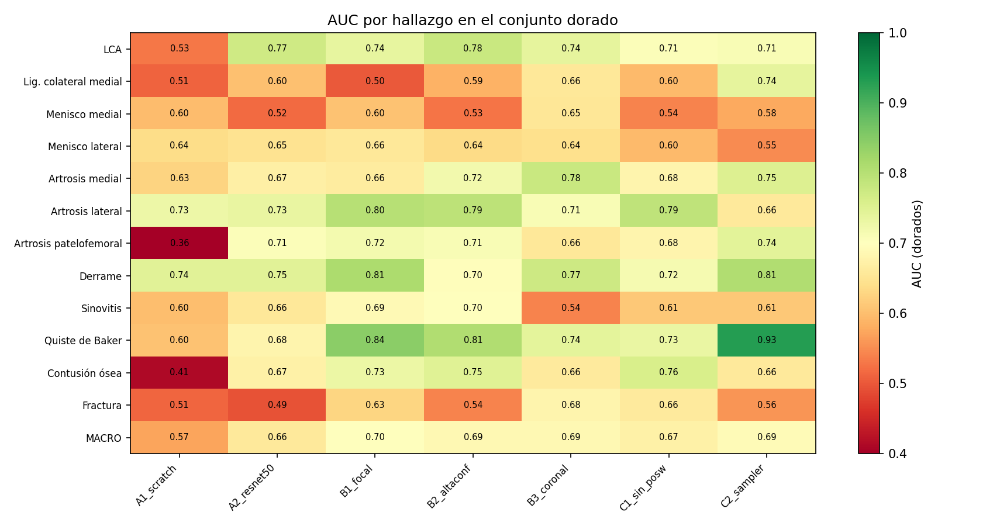
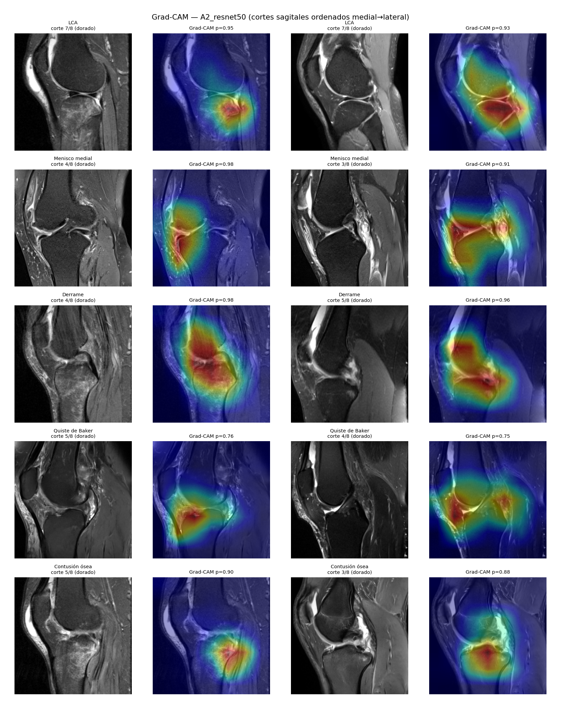

# P1 — Clasificación multietiqueta de anomalías de rodilla en RM con supervisión débil multilingüe

Examen parcial · Redes Neuronales y Aprendizaje Profundo · UNI FIIS 2026-II · Pregunta 1
Datos: competencia [RSNA Knee Abnormality Detection](https://www.kaggle.com/competitions/rsna-knee-abnormality-detection) (Kaggle).

**Equipo:** Salvador Cabrera Taco · Anllelo Carreazo Yrizales · Yda Ramirez Rojas · Pedro Alexander Marquez Lamadrid · Mijael Aguirre Zegarra

**Informe:** [`07_informe/Informe_P1_Rodilla_NeurIPS.pdf`](07_informe/Informe_P1_Rodilla_NeurIPS.pdf)

---

## Reproducir en 3 pasos (Kaggle, ≈ 36 min en GPU T4)

El conjunto de datos pesa ~570 GB, por eso todo se ejecuta **dentro de un Kaggle Notebook**, donde los datos ya están montados. No hay que descargar nada.

1. **Cuenta de Kaggle** con las *Rules* de `rsna-knee-abnormality-detection` aceptadas.
2. **Crear un notebook** (Kaggle → *Create* → *New Notebook*) y en el panel derecho:
   - *Accelerator*: **GPU T4 x1** (no P100: PyTorch reciente ya no la soporta)
   - *Internet*: **ON** (clonar el repo y descargar pesos ImageNet y el modelo NLI)
   - *Add Input* → *Competitions* → **`rsna-knee-abnormality-detection`**
3. **Ejecutar en una celda:**

```bash
!git clone https://github.com/<USUARIO>/<REPO>.git repo && bash repo/03_scripts/run_all.sh
```

Alternativa equivalente: *File → Import Notebook* con [`04_notebooks/P1_kaggle_runner.ipynb`](04_notebooks/P1_kaggle_runner.ipynb) y **Run All**. Ese notebook además compara al final la ejecución nueva contra la oficial.

El **comando único** del pipeline es `bash 03_scripts/run_all.sh`. Las salidas quedan en `/kaggle/working/p1/` con la misma estructura que este repositorio (`02_logs/`, `06_resultados/`).

### Comprobar que la ejecución reproduce los resultados

```bash
!python repo/tools/verificar_resultados.py --oficial repo --nuevo /kaggle/working/p1
```

- Los pasos deterministas (inventario, extractor de reglas, selección del subconjunto) deben dar **exactamente** lo mismo.
- El entrenamiento en GPU **no es determinista bit a bit** (cuDNN y precisión mixta), aunque la semilla está fija (`SEED = 42`). El criterio de reproducción es que el AUC macro dorado de cada run caiga **dentro del IC 95 % bootstrap** de la ejecución oficial.

### Verificación sin GPU ni datos (≈ 1 s)

Para revisar que las tablas del informe salen de los registros por run, sin acceso a Kaggle:

```bash
pip install numpy pandas
python tools/verificar_resultados.py
```

Recalcula los agregados desde `02_logs/runs/*/metricas.json` y `metricas_por_hallazgo.csv` y los compara con `06_resultados/` (32 comprobaciones; debe terminar en `TODO OK`).

---

## Resultados principales (ejecución oficial, 30-oct-2026)

El código de `03_scripts/` es exactamente el que se subió a Kaggle y se ejecutó; `02_logs/`, `06_resultados/` y `04_notebooks/ejecucion_kaggle_2026-10-30.ipynb` son las salidas de esa ejecución, sin modificar (solo se retiraron los archivos con identificadores de estudio).

Conjunto de prueba = estudios con **etiqueta dorada** de radiólogos (56 de 58 tienen serie sagital FS; 54 coronal FS). Nunca se usan para entrenar, elegir épocas ni umbrales.

**Extractor de etiquetas débiles vs dorados** (Entregable 1, `06_resultados/03_resumen.json`)

| Método | AUC macro | IC 95 % | Acuerdo | Tasa de ruido | κ medio |
|---|---|---|---|---|---|
| **Reglas multilingües** (negación, duda, severidad) | **0.784** | [0.742, 0.823] | 0.760 | **0.240** | 0.42 |
| NLI zero-shot (mDeBERTa-v3 XNLI) | 0.638 | [0.588, 0.689] | 0.455 | 0.545 | 0.09 |
| Ensamble | 0.766 | [0.720, 0.807] | 0.695 | 0.305 | 0.32 |

**Clasificador de imagen** (Entregables 2, 3, 4, 6, `06_resultados/08_comparacion_runs.md`)

| Run | Qué cambia respecto de A2 | AUC macro dorado | IC 95 % | F1 macro | Δ AUC pareado vs A2 [IC 95 %] |
|---|---|---|---|---|---|
| A1_scratch | CNN propia 2.5D (1.9 M parámetros) | 0.572 | [0.506, 0.630] | 0.413 | −0.087 [−0.155, −0.016] |
| **A2_resnet50** | base: ResNet-50 ImageNet, BCE, ponderación por confianza, `pos_weight` | 0.658 | [0.601, 0.716] | 0.486 | — |
| B1_focal | pérdida focal (γ = 2) | **0.698** | [0.645, 0.750] | 0.505 | **+0.040 [+0.002, +0.078]** |
| B2_altaconf | solo etiquetas de alta confianza | 0.687 | [0.634, 0.741] | **0.556** | +0.028 [−0.011, +0.069] |
| B3_coronal | plano coronal FS en vez de sagital | 0.686 | [0.627, 0.743] | 0.523 | +0.013 [−0.047, +0.069] |
| C1_sin_posw | sin `pos_weight` | 0.672 | [0.614, 0.728] | 0.466 | +0.014 [−0.041, +0.066] |
| C2_sampler | sobremuestreo de hallazgos raros | 0.691 | [0.642, 0.737] | 0.500 | +0.033 [−0.024, +0.087] |

En pocas palabras: la transferencia desde ImageNet es necesaria (la CNN propia queda 0.087 por debajo, con IC que excluye el cero) y la pérdida focal es la única ablación cuyo IC pareado excluye el cero. Con 56 estudios de prueba, las diferencias de centésimas entre B1, B2, B3 y C2 no son concluyentes.

| AUC por hallazgo y run | Grad-CAM de A2 (cortes sagitales medial → lateral) |
|---|---|
|  |  |

---

## Estructura del repositorio

```
.
├── README.md                     este archivo
├── requirements.txt              dependencias (en Kaggle ya están instaladas)
├── 01_decisiones/decisiones.md   registro de decisiones técnicas D001–D011 (contexto, alternativas, justificación)
├── 02_logs/                      trazabilidad de la ejecución oficial
│   ├── bitacora_ejecuciones.md   una línea por paso/run con su resultado
│   ├── NN_<script>.log           salida completa de cada script
│   └── runs/<run>/               config.json, train.log, historial.csv, metricas.json, metricas_por_hallazgo.csv
├── 03_scripts/                   CÓDIGO: pipeline numerado + run_all.sh  ← comando único
├── 04_notebooks/
│   ├── P1_kaggle_runner.ipynb            notebook limpio para reproducir
│   └── ejecucion_kaggle_2026-10-30.ipynb notebook ejecutado, con sus salidas (evidencia de la corrida oficial)
├── 05_datos/                     CSV intermedios (se generan; no se versionan)
├── 06_resultados/                tablas (.csv/.md/.tex) y figuras/ que usa el informe
├── 07_informe/                   informe NeurIPS (PDF) y discusión de sesgo (Entregable 7)
└── tools/verificar_resultados.py verificación sin GPU y comparación de una ejecución nueva
```

## Pipeline (`03_scripts/`)

| Paso | Script | Qué hace | Entregable | Tiempo T4* |
|---|---|---|---|---|
| 01 | `01_inventario_metadatos.py` | Lee `train.csv` / `train_series.csv`, identifica los 58 dorados, detecta el idioma de cada reporte, cobertura de planos | — | < 1 min |
| 02 | `02_extractor_etiquetas_debiles.py` | Reglas multilingües (10 idiomas) con negación tipo NegEx, duda y severidad → puntaje ordinal + confianza por hallazgo | 1 | < 1 min |
| 04 | `04_seleccion_subconjunto.py` | 500 estudios estratificados (primero hasta 25 positivos débiles de cada hallazgo, del más raro al más común) → train 425 / val 75; dorados = test | 6 | < 1 min |
| 02b | `02b_extractor_nli_multilingue.py` | (Opcional) NLI multilingüe zero-shot, pesos abiertos, dentro del notebook | 1 | ≈ 3 min |
| 03 | `03_validar_extractor_vs_dorados.py` | AUC, acuerdo, κ y tasa de ruido por hallazgo e idioma | 1, 7 | < 1 min |
| 05 | `05_cache_dicom_25d.py` | DICOM → 9 cortes 2.5D por estudio, lateralidad canonicalizada (medial → lateral), uint8 | — | ≈ 1 min/plano |
| 06 | `06_entrenar_evaluar.py` | Entrena un run (encoder 2D + atención por hallazgo + 12 sigmoides) y lo evalúa en dorados: AUC macro, IC bootstrap, P/R/F1 | 2, 3, 4, 6 | 1–4 min/run |
| 07 | `07_gradcam.py` | Atención por corte + Grad-CAM en 5 hallazgos | 5 | < 1 min |
| 08 | `08_tablas_para_informe.py` | Consolida runs, ablaciones pareadas (bootstrap) y desbalance | 3, 4, 6 | < 1 min |

\* Tiempos de la ejecución oficial, tomados de `02_logs/bitacora_ejecuciones.md`. Total ≈ 36 min.

`run_all.sh` ejecuta todo en este orden. Cada paso también se puede correr suelto, por ejemplo:

```bash
cd 03_scripts
python 06_entrenar_evaluar.py --run B1_focal --arch resnet50 --loss focal
python 06_entrenar_evaluar.py --help        # todas las opciones (arquitectura, plano, pérdida, ruido, desbalance…)
```

Archivos de apoyo: `config.py` (rutas, etiquetas, hiperparámetros por defecto, semilla), `p1lib.py` (dataset 2.5D, arquitecturas, pérdidas), `metricas.py` (AUC macro, bootstrap, umbrales).

## Dónde está cada entregable del enunciado

| # | Entregable | Código | Evidencia |
|---|---|---|---|
| 1 | Extractor de etiquetas débiles + tasa de acuerdo/ruido vs dorados | `02_…`, `02b_…`, `03_…` | `06_resultados/03_validacion_extractor.csv`, `03_resumen.json`, `figuras/03_extractor_auc_por_hallazgo.png` |
| 2 | ≥ 2 arquitecturas: CNN desde cero y ImageNet con 12 sigmoides | `06_…` (A1, A2), `p1lib.py` | `02_logs/runs/A1_scratch/`, `02_logs/runs/A2_resnet50/` |
| 3 | AUC-ROC macro + desglose por hallazgo + P/R/F1 a umbral justificado | `06_…`, `08_…` | `06_resultados/08_comparacion_runs.md`, `08_auc_por_hallazgo.csv`, `02_logs/runs/*/metricas_por_hallazgo.csv` |
| 4 | Ablación de ≥ 2 factores (pérdida, ruido, plano) | `06_…` (B1, B2, B3), `08_…` | `06_resultados/08_ablaciones_pareadas.csv` |
| 5 | Grad-CAM en ≥ 3 hallazgos + plausibilidad anatómica | `07_gradcam.py` | `06_resultados/figuras/07_gradcam_*.png`, `07_atencion_*.png` |
| 6 | Prevalencia de los 12 hallazgos + mitigación evaluada | `04_…`, `06_…` (C1, C2) | `06_resultados/04_prevalencia.csv`, `08_desbalance.csv` |
| 7 | Discusión de sesgo geográfico/lingüístico | `03_…` (acuerdo por idioma) | `07_informe/discusion_sesgo_linguistico.md`, `06_resultados/03_acuerdo_por_idioma.csv` |

## Decisiones de diseño (resumen)

El detalle, las alternativas descartadas y la justificación están en [`01_decisiones/decisiones.md`](01_decisiones/decisiones.md).

- **Escala reducida:** 500 estudios no dorados + 58 dorados como prueba; un plano por modelo (sagital PD/T2 FS; coronal FS en la ablación B3); 9 cortes 2.5D por estudio.
- **Etiquetas débiles:** salida ordinal (0.05 negado … 0.95 severo) y una confianza por hallazgo; "no mencionado" recibe confianza baja en reportes cortos. La confianza pondera la pérdida.
- **Lateralidad:** se canonicaliza para que "medial" esté siempre del mismo lado; por eso **no** se usa flip horizontal como aumento (intercambiaría medial y lateral en 5 de las 12 etiquetas).
- **Modelo:** encoder 2D compartido por corte + atención por hallazgo sobre los cortes + 12 sigmoides. La atención dice *qué corte* miró el modelo y Grad-CAM *dónde* dentro del corte.
- **Evaluación:** AUC-ROC macro (métrica oficial) en dorados con IC 95 % bootstrap (1000 remuestreos); umbral por hallazgo = máximo F1 en validación débil; ablaciones con Δ AUC e IC bootstrap pareado (2000 remuestreos).

## Ejecutar fuera de Kaggle

No lo probamos fuera de Kaggle, pero el código no depende de Kaggle. Hace falta una GPU con ~16 GB y los datos de la competencia (`train.csv`, `train_series.csv` y `train_series/<StudyInstanceUID>/<SeriesInstanceUID>/*.dcm`).

```bash
pip install -r requirements.txt
export P1_DATA_ROOT=/ruta/a/rsna-knee-abnormality-detection
export P1_WORK=$PWD/salida_local      # para no sobrescribir los resultados versionados
bash 03_scripts/run_all.sh
python tools/verificar_resultados.py --nuevo salida_local
```

| Variable | Por defecto | Uso |
|---|---|---|
| `P1_DATA_ROOT` | se busca bajo `/kaggle/input` | carpeta con `train.csv` y `train_series/` |
| `P1_WORK` | `/kaggle/working/p1` en Kaggle; la raíz del repo fuera de Kaggle | dónde se escriben logs, tablas y figuras |
| `P1_CACHE` | `$P1_WORK/cache` | caché 2.5D (`.npy`) |
| `P1_N_SUBSET` | 500 | estudios no dorados del subconjunto |
| `P1_MIN_POS` | 25 | positivos débiles mínimos por hallazgo |

## Problemas frecuentes

| Síntoma | Solución |
|---|---|
| `No encuentro los datos…` | Falta *Add Input → Competitions → rsna-knee-abnormality-detection*, o la cuenta no aceptó las *Rules*. |
| Error de CUDA / GPU no compatible | Cambiar el acelerador a **T4** (P100 no es compatible con PyTorch reciente). |
| `CUDA out of memory` en el paso 06 | Añadir `--bs 4` a los comandos de `06_entrenar_evaluar.py` en `run_all.sh`. |
| Falla la descarga de pesos o del modelo NLI | Activar **Internet: ON**. El paso 02b es opcional: si falla, `run_all.sh` sigue (`[aviso] NLI omitido`), pero el paso 03 solo reportará el extractor de reglas. |
| `FutureWarning: torch.cuda.amp.GradScaler … deprecated` | Es solo un aviso; también aparece en la ejecución oficial. |

## Datos, privacidad e integridad

- **No se versionan** DICOM, CSV intermedios de `05_datos/` (contienen `StudyInstanceUID` y texto derivado de los reportes), predicciones por estudio (`pred_*.csv`, contienen las etiquetas doradas por estudio), cachés ni pesos (`.gitignore`, decisión D010). Todo se regenera con `run_all.sh`.
- Las figuras de Grad-CAM muestran cortes de RM de la competencia, igual que el informe.
- El texto de los reportes no se envía a ningún servicio externo; el modelo NLI corre dentro del notebook con pesos abiertos.
- El código es del grupo. Los hallazgos empíricos publicados por otros participantes se citan en `01_decisiones` y en el informe; no se reutiliza su código.

## Limitaciones

Prueba pequeña (56 estudios; el IC del AUC macro mide ±0.06 y el de cada hallazgo ±0.1–0.2), etiquetas de reporte frente a etiquetas de imagen, partición aleatoria sin agrupar por sitio, una semilla por configuración y 500 de ~3 900 estudios disponibles. Ver sección 7 del informe.
